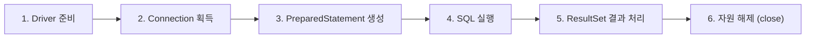

# 261022 학습 정리: 데이터 모델링 & JDBC

---

## 1. 데이터 모델링 (Data Modeling)

### 1.1 카디널리티 (Cardinality)의 두 가지 의미
1. **관계 차수 (ERD 관점):** 엔티티 간 관계의 수적 대응 비율 (1:1, 1:N, M:N).
2. **튜플의 수 (관계대수/수학 관점):** 특정 테이블(릴레이션)에 존재하는 행(Row)의 총 개수. (컬럼의 수는 '차수(Degree)'라고 함)

---

### 1.2 모델링 3단계 흐름

| 단계 | 주요 작업 | 특징 |
| :--- | :--- | :--- |
| **개념 모델 (Conceptual)** | 핵심 엔티티 도출, 주요 관계 정의 | 업무 영역의 큰 그림 파악 |
| **논리 모델 (Logical)** | 상세 속성 정의, 식별자(PK/FK) 확정, **정규화(1~3NF)** | **DBMS 독립적** (MySQL, Oracle 상관없이 유지) |
| **물리 모델 (Physical)** | DBMS 선정, 구체적 데이터 타입/길이 지정, **반정규화(비정규화)**, 인덱스/뷰 설계 | **DBMS 종속적**, 실제 운영 성능 및 스토리지 고려 |

---

### 1.3 정규화 (Normalization) & 함수 종속성

정규화는 **데이터 중복을 최소화**하고 데이터 조작 시 발생하는 **이상 현상(Anomaly: 삽입, 삭제, 갱신 이상)**을 방지하기 위해 테이블을 분해하는 과정입니다.

#### 함수 종속 (Functional Dependency)
* $X \rightarrow Y$ : 속성 $X$의 값이 결정되면 속성 $Y$의 값이 오직 하나로 결정될 때, "$Y$는 $X$에 함수적으로 종속된다"고 합니다. ($X$: 결정자, $Y$: 종속자)

#### 정규형 단계 요약 (암기 팁: 원-부-이)

```
[비정규 테이블]
      │
      ▼ (1NF: 원자값 보장 - 반복 그룹/다가 속성/복합 속성 분리)
[제1정규형 테이블]
      │
      ▼ (2NF: 부분 함수 종속 제거 - 복합 PK 전체에 종속되도록 분리)
[제2정규형 테이블]
      │
      ▼ (3NF: 이행적 함수 종속 제거 - 기본키가 아닌 일반 컬럼 간 종속 분리)
[제3정규형 테이블]
```

1. **제1정규형 (1NF) - 원자성 (Atomicity)**
   * 모든 속성의 값은 **단 하나의 원자값(Atomic Value)**이어야 합니다.
   * **다가 속성 (Multi-valued Attribute):** 취미가 여러 개라고 `취미1, 취미2, 취미3` 컬럼을 늘리지 않고, 별도의 자식 테이블(1:N)로 분리합니다.
   * **복합 속성 (Composite Attribute):** `주소` 속성은 `[시/도, 시/군/구, 상세주소]`처럼 의미 있는 최소 단위로 분해하여 저장합니다.

2. **제2정규형 (2NF) - 완전 함수 종속 (Full Functional Dependency)**
   * 기본키가 **복합키(2개 이상의 컬럼으로 구성)**일 때, 기본키의 **일부 컬럼에만 종속되는 속성(부분 함수 종속)**을 별도 테이블로 분리합니다.
   * *(단일 컬럼 PK를 가진 테이블은 1NF를 만족하면 자동으로 2NF를 만족합니다.)*

3. **제3정규형 (3NF) - 이행적 함수 종속 제거 (Transitive Dependency)**
   * $A \rightarrow B$ 이고 $B \rightarrow C$ 성립 시 $A \rightarrow C$가 되는 관계를 제거합니다.
   * 즉, **기본키($A$)가 아닌 일반 속성($B$)이 또 다른 일반 속성($C$)을 결정하는 경우** 테이블을 분리합니다.
   * *예: `[주문번호(PK), 고객ID, 고객등급, 할인율]` 구조에서 `고객등급`에 따라 `할인율`이 결정된다면 등급 테이블을 별도로 분리해야 합니다.*

---

### 1.4 물리 모델링과 비정규화 (반정규화, Denormalization)

* **비정규화의 정의:** 정규화를 잘못해서 되돌리는 것이 아니라, 시스템 성능 향상(조인 비용 감소, 디스크 I/O 절감)을 위해 **의도적으로 중복·통합·분할**을 수행하는 기법입니다.
* **테이블 수직 분할 (1:1 분할):**
  * 하나의 테이블에 수십 개의 컬럼이 존재할 때, 자주 조회되는 핵심 컬럼과 거의 조회되지 않거나 특정 부서만 사용하는 컬럼을 **1:1 식별/비식별 관계의 테이블로 분리**하여 I/O 성능을 높입니다.
* **슈퍼타입 / 서브타입 물리 변환 3대 모델:**
  1. **One Table (Single Table / Roll-up):** 모든 서브타입을 하나의 큰 테이블로 통합 (조인 불필요, Null 허용 컬럼 증가).
  2. **Table per Class (Roll-down):** 서브타입마다 개별 테이블을 생성하고 공통 컬럼을 각자 소유 (공통 데이터 관리 어려움).
  3. **Join 모델 (1:1 분할):** 슈퍼타입 공통 테이블 1개 + 서브타입 개별 테이블 N개로 1:1 PK-FK 매핑 (정규화 유지, 조회 시 조인 비용 발생).

---

## 2. JDBC (Java DataBase Connectivity)

### 2.1 JDBC 정의 및 아키텍처
* **정의:** 자바 애플리케이션에서 관계형 데이터베이스(RDBMS)에 접근하고 SQL을 실행할 수 있도록 표준화한 Java SE 표준 API (`java.sql`, `javax.sql`).
* **동작 구조:**
  * **JDBC API (인터페이스):** `Connection`, `Statement`, `ResultSet` 등 자바 표준 규격.
  * **JDBC Driver (구현체):** MySQL, Oracle 등 각 DB 제조사가 인터페이스 규격에 맞춰 제작한 통신 라이브러리 (예: `mysql-connector-j`).

---

### 2.2 JDBC 기본 흐름 (6단계)



1. **드라이버 로딩:** `Class.forName("com.mysql.cj.jdbc.Driver");` (최신 JDBC 4.0 이후 라이브러리 추가 시 자동 감지)
2. **연결 수립:** `DriverManager.getConnection(url, user, password)`을 통해 DB 세션 연결 통로(`Connection`) 획득
3. **SQL 객체 준비:** `conn.prepareStatement(sql)`을 통해 쿼리 템플릿 준비
4. **파라미터 바인딩 및 실행:**
   * 조회(SELECT): `pstmt.executeQuery()` $\rightarrow$ `ResultSet` 반환
   * 변경(INSERT/UPDATE/DELETE): `pstmt.executeUpdate()` $\rightarrow$ 변경된 행의 개수(`int`) 반환
5. **결과 처리:** `rs.next()`로 커서를 한 행씩 전진시키며 데이터 추출 (`rs.getString()`, `rs.getInt()`)
6. **자원 정리:** 열었던 역순으로 `close()` 호출 (또는 `try-with-resources`로 자동 관리)

---

### 2.3 표준 코드 예제 (`try-with-resources` & `PreparedStatement`)

```java
import java.sql.Connection;
import java.sql.DriverManager;
import java.sql.PreparedStatement;
import java.sql.ResultSet;
import java.sql.SQLException;

public class JdbcExample {
    // 1. DB 접속 URL 설정
    private static final String URL = "jdbc:mysql://localhost:3306/mydb?useSSL=false&serverTimezone=UTC&characterEncoding=UTF-8";
    private static final String USER = "root";
    private static final String PASSWORD = "password";

    public static void main(String[] args) {
        String sql = "SELECT id, name, email FROM members WHERE status = ? AND age >= ?";

        // 2. try-with-resources: 예외 발생 여부와 상관없이 열린 자원을 자동으로 안전하게 close()
        try (Connection conn = DriverManager.getConnection(URL, USER, PASSWORD);
             PreparedStatement pstmt = conn.prepareStatement(sql)) {

            // 3. 파라미터 바인딩 (? 위치에 값 매핑, 1부터 시작)
            // SQL Injection 방어 및 쿼리 캐싱 최적화
            pstmt.setString(1, "ACTIVE");
            pstmt.setInt(2, 20);

            // 4. 쿼리 실행 및 결과 조회
            try (ResultSet rs = pstmt.executeQuery()) {
                // 커서(Cursor)를 첫 행부터 끝 행까지 이동
                while (rs.next()) {
                    int id = rs.getInt("id");
                    String name = rs.getString("name");
                    String email = rs.getString("email");

                    System.out.println(id + " | " + name + " | " + email);
                }
            }

        } catch (SQLException e) {
            e.printStackTrace();
        }
    }
}
```

---

### 2.4 핵심 비교 포인트: `Statement` vs `PreparedStatement`

| 구분 | `Statement` | `PreparedStatement` (권장) |
| :--- | :--- | :--- |
| **SQL 형태** | 완성된 문자열 형태 | `?` (플레이스홀더)를 포함한 템플릿 형태 |
| **컴파일 방식** | 매 실행 시마다 DB가 쿼리를 재파싱/컴파일 | 최초 1회 파싱/컴파일 후 **캐싱하여 재사용** (성능 우수) |
| **보안성** | **SQL Injection 공격에 취약** | 입력값을 텍스트 리터럴로 자동 이스케이프하여 **SQL Injection 원천 차단** |
