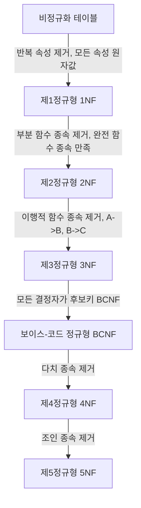

# [TIL] 데이터 모델링(Data Modeling) 완벽 정리 🚀

> **작성일**: 2026-10-21  
> **태그**: `#Database` `#DataModeling` `#RDB` `#정규화` `#물리모델링` `#면접대비`  
> **한 줄 요약**: 현실 세계의 비즈니스 규칙을 컴퓨터가 다룰 수 있는 무결성 높은 관계형 데이터 구조로 체계화하고 최적화하는 전체 라이프사이클 마스터하기!

---

## 📌 목차
1. [데이터 모델링 개요](#1-데이터-모델링-개요)
2. [엔터티(Entity)와 속성(Attribute)](#2-엔터티entity와-속성attribute)
3. [관계(Relationship)와 식별자(Identifier)](#3-관계relationship와-식별자identifier)
4. [개념 모델링 (Conceptual Modeling)](#4-개념-모델링-conceptual-modeling)
5. [논리 모델링 & 이상 현상 & 정규화](#5-논리-모델링--이상-현상--정규화)
6. [물리 모델링 & 비정규화 & 성능 최적화](#6-물리-모델링--비정규화--성능-최적화)
7. [💡 백엔드/데이터 직무 면접 단골 Q&A](#-백엔드데이터-직무-면접-단골-qa)

---

## 1. 데이터 모델링 개요

### 1-1. 모델링(Modeling)이란?
- **개념**: 복잡한 현실 세계를 단순화·추상화·명확화하여 일정한 표기법으로 표현하는 작업.
- **필요성**:
  - 작은 시냇물에 디딤돌을 놓는 일은 설계도가 없어도 되지만, **큰 다리를 건설하려면 정확한 설계도와 모형이 필수적**이다.
  - 시스템 구축 시 이해관계자 간의 **의사소통, 시뮬레이션, 문제 해결, 핵심 파악, 연구/개발의 기준**이 됨.
- **모델링의 3대 특징**:
  1. **단순화(Simplification)**: 선택과 집중을 통해 필요한 것만 추려냄.
  2. **추상화(Abstraction)**: 다양한 현상을 일정한 표기법으로 묶어 표현함.
  3. **명확화(Clarity)**: 애매모호함을 없애고 누구나 동일하게 이해하도록 명확히 기술함.

### 1-2. 데이터 저장 방식의 발전과 RDB의 필요성
| 저장 방식 | 특징 및 장점 | 한계 및 문제점 |
| :--- | :--- | :--- |
| **메모리(RAM)** | 초고속 처리 | 프로세스 종료나 PC 전원 OFF 시 데이터 휘발 |
| **파일(텍스트/이진)** | 영구 디스크 보관 가능 | 시스템 장애 시 원상태 복구 극히 어려움, 바이너리 해석 불가 |
| **엑셀(Spreadsheet)** | 2차원 표로 한눈에 데이터 파악 용이 | 데이터 증가 시 중복 폭증, 10만 행 이상 시 성능 급저하, 동시성/수정/삭제 시 이상 현상 |
| **관계형 DB (RDBMS)** | 데이터 분류/관계 명확화, 중복 제거, 무결성 보장 | 초기 구조 설계(데이터 모델링)가 필수적임 |

### 1-3. 소프트웨어 개발 생명주기와 3가지 관점 모델링
- **소프트웨어 개발 절차**: 요구사항 분석 ➡️ 프로그램 설계 ➡️ 프로그램 구현 ➡️ 통합/테스트 ➡️ 유지보수
- **정보 시스템 모델링의 3대 축**:
  1. **데이터 관점**: 어떤 데이터가 필요하고 데이터 간의 관계는 무엇인가? (ERD, 물리 DB 구축, 튜닝)
  2. **프로세스 관점**: 업무가 어떻게 구성되고 처리 절차와 방법이 어떠한가?
  3. **상관 관점**: 업무 흐름(프로세스)에 따라 데이터가 어떻게 생성/수정/삭제(CRUD)되는가?

### 1-4. 표기법 (ERD Notations)
- **피터 첸(Peter Chen) 표기법**: 1976년 창안, 학술적/개념적 모델에 주로 활용 (마름모: 관계, 타원: 속성).
- **IE(Information Engineering) 표기법**: 까마귀 발(Crow's Foot) 표기법으로 널리 알려진 실무 범용 표기법.
- **바커(Barker) 표기법**: 오라클/데이터 아키텍처 전문가(DAP)에서 선호, 배타적 관계나 슈퍼-서브타입을 박스 안에 중첩하여 직관적으로 표현.

### 1-5. 데이터 무결성(Integrity) vs 정합성(Consistency)
> ⚠️ **핵심 차이**:
> - **정합성(Consistency)**: 데이터 간에 모순이 없고 서로 일치하는가?
> - **무결성(Integrity)**: 데이터가 정확하고 완전하며 유효한가?  
> *(모든 데이터가 통일되게 틀린 값으로 채워져 있다면 정합성은 맞지만 무결성은 깨진 상태)*

#### 데이터 무결성의 4대 종류
1. **엔터티 무결성 (Entity Integrity)**: 모든 인스턴스는 고유해야 하며, 기본키(PK)는 중복되거나 `NULL`일 수 없음.
2. **참조 무결성 (Referential Integrity)**: 외래키(FK) 값은 참조하는 부모의 기본키 값이거나 `NULL`이어야 함.
3. **도메인 무결성 (Domain Integrity)**: 속성 값은 정의된 데이터 타입, 길이, 허용값 범주, 기본값 규칙을 준수해야 함.
4. **업무 무결성 (Business Integrity)**: 기업 비즈니스 규칙과 프로세스 정책을 만족해야 함 (예: 대출 한도 규정 등).

---

## 2. 엔터티(Entity)와 속성(Attribute)

### 2-1. 엔터티(Entity)의 정의와 도출 원칙
- **정의**: 업무 관심 대상이 되는 유·무형의 정보 단위(개체).
- **도출 원칙**:
  - 반드시 업무상 관리해야 하는 관심 대상이어야 한다.
  - **2개 이상의 인스턴스(행)**를 가져야 한다. (인스턴스가 1개뿐이면 엔터티가 아님)
  - 인스턴스를 유일하게 식별할 수 있는 **식별자(Identifier)**가 존재해야 한다.
  - 고유한 성격을 지닌 1개의 독립된 주제여야 한다.

### 2-2. 엔터티 도출 실무 프로세스
```
[업무 기술서/인터뷰/전표 분석] 
       ⬇️ (명사 추출)
[엔터티 후보 풀 & 엔터티 리스트 생성]
       ⬇️ (속성 vs 엔터티 구분 & 중복 정리)
[식별자 정의 및 엔터티 기술서 작성]
```

### 2-3. 발생 시점에 따른 엔터티의 4대 분류
1. **실체 엔터티 (Fundamental / Tangible Entity)**:
   - 물리적 형태가 있거나 본질적인 개체 (사원, 고객, 제품, 창고, 학생).
2. **기준 엔터티 (Reference Entity)**:
   - 다른 엔터티의 기준이 되는 참조성 데이터 (우편번호, 이자율, 코드성 데이터). 단 하나만 유지.
3. **행위 엔터티 (Active / Event Entity)**:
   - 업무 활동 중 발생하는 원천 트랜잭션 데이터 (주문, 결제, 계약, 입금). 빈번히 생성되고 변경됨.
4. **가공 엔터티 (Summary / Derived Entity)**:
   - 원천 데이터를 집계/가공/요약한 데이터 (일별 매출 집계, 회원 통계 요약).

### 2-4. 속성(Attribute)의 분류
- **분해 가능 여부에 따른 분류**:
  - **단일 속성**: 하나의 독립된 의미 (상품명, 수량, 단가).
  - **복합 속성**: 여러 하위 속성으로 분해 가능 (주소: 시/구/동, 전화번호: 국번/번호).
  - **다가 속성 (Multi-valued)**: 하나의 인스턴스에 여러 값이 들어갈 수 있는 속성 (취미, 복수 전공) ➡️ **제1정규화 대상!**
- **특성에 따른 분류**:
  - **기초(본질) 속성**: 엔터티 고유의 본질적인 속성 (고객명, 생년월일).
  - **관계 속성**: 타 엔터티와의 관계를 통해 생성되는 외래키(FK).
  - **추출(유도) 속성**: 다른 속성값으로부터 계산되어 생성되는 속성 (총 결제금액, 평균 점수).

### 2-5. 도메인 (Domain)
- 속성이 가질 수 있는 **동일한 타입의 원자값(Atomic Value)들의 집합**.
- 도메인을 표준화하면 데이터 타입, 길이, 제약조건을 통일하여 시스템 전반의 정합성을 보장할 수 있음.

---

## 3. 관계(Relationship)와 식별자(Identifier)

### 3-1. 식별자 (Identifier)
- **주식별자(Primary Identifier)의 4대 조건**:
  1. **유일성**: 모든 인스턴스를 고유하게 식별.
  2. **최소성**: 유일성을 보장하는 최소한의 속성으로만 구성.
  3. **불변성**: 식별자 값은 한 번 정해지면 변경되지 않아야 함.
  4. **존재성**: 절대 `NULL`이 올 수 없음 (NOT NULL).
- **외래식별자(Foreign Identifier, FK)**: 부모 엔터티의 주식별자를 자식 엔터티가 참조하기 위한 연결 고리.

### 3-2. 관계의 구성요소
```
[부모 엔터티] ------------< (카디널리티: 1:N)
             |          |
        [옵셔널리티: 필수/선택]
```

1. **카디널리티 (Cardinality)**: 인스턴스 간 매핑 비율 ($1:1$, $1:N$, $M:N$).
   > ⚠️ **$M:N$ 관계**는 실무 DB에서 직접 구현할 수 없으므로, **교차 엔터티(Association Entity)**를 생성하여 **두 개의 $1:N$ 관계로 해소**해야 한다!
2. **옵셔널리티 (Optionality)**:
   - **Mandatory (필수, `|`)**: 반드시 최소 1개 이상 존재해야 함.
   - **Optional (선택, `O`)**: 없어도 됨 (0개 이상).
3. **관계 디그리 (Degree)**: 관계에 참여하는 엔터티의 수 (1항: 재귀, 2항: 이항, 3항 이상: 다항).

### 3-3. 특별한 관계 형태
- **일대일(1:1) 관계**: 테이블 수직 분할, 성능 이슈, 보안 분리 목적으로 채택.
- **배타 관계 (Exclusive Relationship)**: 여러 상위 엔터티 중 **오직 1개와만 배타적으로 관계를 맺음** (예: 회원이 일반 고객이거나 임직원 중 하나에만 속함).
- **재귀 관계 (Self-referencing / Recursive)**: 같은 엔터티 내에서 상위-하위 인스턴스 간 관계를 맺음 (예: 조직도, 상사 사번, 카테고리 계층). 테이블 증가를 방지함.

---

## 4. 개념 모델링 (Conceptual Modeling)


- **핵심 역할**: 요구사항을 기반으로 핵심 엔터티(Entity), 주요 속성, 엔터티 간 관계(Relationship)를 도출한 상위 수준의 ERD 작성.
- **목적**:
  - 비즈니스 이해관계자(기획자, 현업, 개발자, DBA) 간의 소통 브릿지.
  - 업무의 큰 틀(Boundary)을 확정.
- **주의 사항**:
  - 논리 모델링 기간의 약 1/3을 투자할 만큼 충분한 소통이 필요함.
  - 기술적 구현 세부사항에 매몰되지 말고 비즈니스 데이터 본질에 집중할 것.
  - 과도한 복잡성에 빠지지 않도록 유의.

---

## 5. 논리 모델링 & 이상 현상 & 정규화

### 5-1. 데이터 이상 현상 (Anomaly)
중복된 데이터 구조 때문에 발생하는 비정상적인 부작용:
- **삽입 이상 (Insertion Anomaly)**: 불필요한 정보를 함께 입력하지 않고는 원하는 데이터를 삽입할 수 없음 (예: 주문 없는 신규 상품 등록 불가).
- **갱신 이상 (Update Anomaly)**: 중복 데이터 중 일부만 수정되어 데이터 불일치 모순 발생.
- **삭제 이상 (Deletion Anomaly)**: 특정 정보를 삭제할 때 연관된 유용한 다른 정보까지 의도치 않게 동시 삭제됨.

### 5-2. 함수 종속성 (Functional Dependency)
- 어떤 속성 $X$의 값에 의해 속성 $Y$의 값이 유일하게 결정될 때, **"$Y$는 $X$에 함수적으로 종속된다 ($X \to Y$)"**라고 함.
- $X$: **결정자 (Determinant)**, $Y$: **종속자 (Dependent)**.

### 5-3. 정규화(Normalization) 단계별 정리



| 정규형 | 조건 (규칙) | 해결 방법 및 예시 |
| :--- | :--- | :--- |
| **제1정규형 (1NF)** | 모든 속성은 **원자값(Atomic Value)**을 가져야 함 (다가 속성/반복 그룹 제거) | 취미 1, 취미 2 또는 콤마로 나열된 속성을 별도 엔터티(1:N)로 분리 |
| **제2정규형 (2NF)** | **부분 함수 종속성 제거** (복합 기본키의 일부에만 종속되는 속성 분리) | (주문번호, 상품번호) 복합키에서 상품명은 상품번호에만 종속되므로 상품 엔터티 분리 |
| **제3정규형 (3NF)** | **이행적 함수 종속성 제거** ($X \to Y$ 이고 $Y \to Z$ 일 때 $X \to Z$ 관계 제거) | [사원번호 $\to$ 부서코드 $\to$ 부서명] 구조에서 부서코드와 부서명을 별도 엔터티로 분리 |
| **BCNF** | **모든 결정자가 후보키(Candidate Key)**여야 함 | 후보키가 아닌 결정자 속성을 별도 엔터티로 분리 |

---

## 6. 물리 모델링 & 비정규화 & 성능 최적화

### 6-1. 물리 모델링의 특징
- 특정 DBMS(MySQL, PostgreSQL, Oracle 등) 제품의 물리적 특성을 고려하여 실제 테이블, 인덱스, 컬럼 타입, 제약조건을 구현하는 단계.
- **원칙**: 논리 모델 구조에서 가급적 10% 이내의 변화만 허용하며, 뚜렷한 성능 이슈가 있을 때만 비정규화를 검토.

### 6-2. 슈퍼타입 / 서브타입 물리 변환 기법
| 변환 방식 | 구조 | 장점 | 단점 |
| :--- | :--- | :--- | :--- |
| **통합 엔터티 (Single Table)** | 슈퍼타입 + 모든 서브타입을 하나의 테이블로 통합 | 조인이 필요 없어 조회 속도 빠름, 관리 단순 | 테이블 컬럼 증가, 서브타입 컬럼에 `NULL` 허용 필수 (무결성 취약) |
| **개별 엔터티 (Table per Subtype)** | 각 서브타입별로 각각 독립된 테이블 분리 생성 | 불필요한 컬럼 없음, NOT NULL 제약 가능 | 전체 데이터 조회 시 `UNION` 필요, 통합 처리 복잡 |

### 6-3. 성능 최적화 수단: 뷰(View) & 인덱스(Index)
- **뷰 (View)**: 
  - 복잡한 조인 쿼리를 가상 테이블 형태로 추상화하여 제공.
  - 데이터 접근 권한을 제어하여 보안성을 강화.
- **인덱스 (Index)**:
  - 지정한 컬럼을 기준으로 정렬된 색인 트리를 구성하여 탐색 속도 비약적 향상.
  - WHERE절 조건, JOIN 조건 컬럼에 설정.
  - **효과적인 경우**: 전체 데이터 중 검색 결과가 **10~15% 미만**으로 좁혀지는 고선택도(High Selectivity) 컬럼.
  - **주의점**: 테이블 크기가 작거나 중복도가 높은 컬럼에는 효과 미미, 과도한 인덱스는 INSERT/UPDATE/DELETE 성능을 떨어뜨림.

### 6-4. 비정규화 (Denormalization / 역정규화)
- **개념**: 정규화된 모델에서 시스템 성능(주로 읽기/검색 속도) 향상을 위해 데이터 중복을 계획적으로 허용하는 설계 기법.
- **비정규화의 4가지 유형**:
  1. **수직 분할 (Vertical Partitioning)**: 하나의 테이블에서 자주 쓰이는 컬럼과 안 쓰이는 대용량 컬럼(LOB, 텍스트)을 1:1로 테이블 분리.
  2. **수평 분할 (Horizontal Partitioning / 파티셔닝)**: 데이터의 기간(연도별)이나 빈도(상위 20% vs 나머지 80%)에 따라 행 단위로 분할.
  3. **속성 중복 (Duplicate Column)**: 조인 비용을 줄이기 위해 부모 테이블의 속성을 자식 테이블에 중복 저장 (예: 주문내역에 매번 주문업체명을 복제 저장).
  4. **엔터티 통합 (Merge Tables)**: 빈번하게 조인되는 1:1 혹은 1:N 관계의 테이블을 하나로 합쳐 조인 연산 제거.
> ⚠️ **트레이드오프(Trade-off)**: 비정규화는 조회 성능을 얻는 대신 **데이터 정합성 불일치 위험**과 **CUD(생성/수정/삭제) 성능 저하**를 수반하므로 신중해야 함!

---

## 7. 💡 백엔드/데이터 직무 면접 단골 Q&A

### Q1. "데이터 무결성과 정합성의 차이점을 설명해보세요."
> **답변 핵심**:  
> "데이터 정합성은 데이터 간에 모순이 없이 일관되게 일치하는 상태를 뜻합니다. 반면 데이터 무결성은 데이터가 결함 없이 정확하고 유효한 상태를 의미합니다. 예를 들어 어떤 데이터가 모든 테이블에서 일관되게 잘못된 값으로 저장되어 있다면, 정합성은 만족하지만 무결성은 위반된 상태입니다."

### Q2. "제1, 제2, 제3 정규화에 대해 실무 예시와 함께 설명해주세요."
> **답변 핵심**:  
> - **1NF**: 모든 컬럼이 원자값을 가져야 합니다. 한 회원이 여러 취미를 콤마로 저장하고 있다면 취미 테이블을 분리하여 1NF를 만족합니다.
> - **2NF**: 복합키 구조에서 기본키의 일부분에만 종속되는 부분 함수 종속을 제거합니다. 예를 들어 `(주문번호, 상품번호)` 복합키에서 상품 가격이 상품번호에만 종속된다면 상품 테이블로 분리합니다.
> - **3NF**: 일반 속성 간의 이행적 함수 종속($A \to B \to C$)을 제거합니다. `사원번호(PK) -> 부서코드 -> 부서명` 구조에서 부서명을 사원 테이블이 아닌 부서 테이블로 분리하는 것이 3NF입니다.

### Q3. "비정규화(역정규화)는 언제 진행하며, 어떤 트레이드오프가 있나요?"
> **답변 핵심**:  
> "비정규화는 정규화가 완료된 후, 대규모 트래픽이나 복잡한 조인 연산으로 인해 조회 성능 저하가 발생할 때 검색 성능을 최적화하기 위해 적용합니다.  
> 트레이드오프는 데이터 중복으로 인해 읽기(SELECT) 성능은 대폭 향상되지만, 쓰기(INSERT/UPDATE/DELETE) 시 추가적인 연산과 지연이 발생하며, 데이터 불일치(이상 현상)로 인한 데이터 무결성 훼손 위험을 항상 관리해야 한다는 점입니다."
